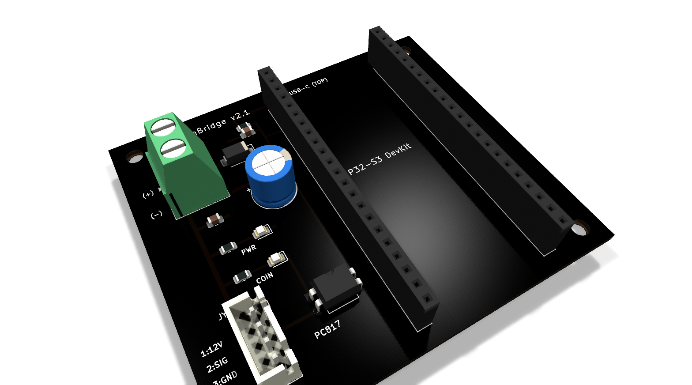
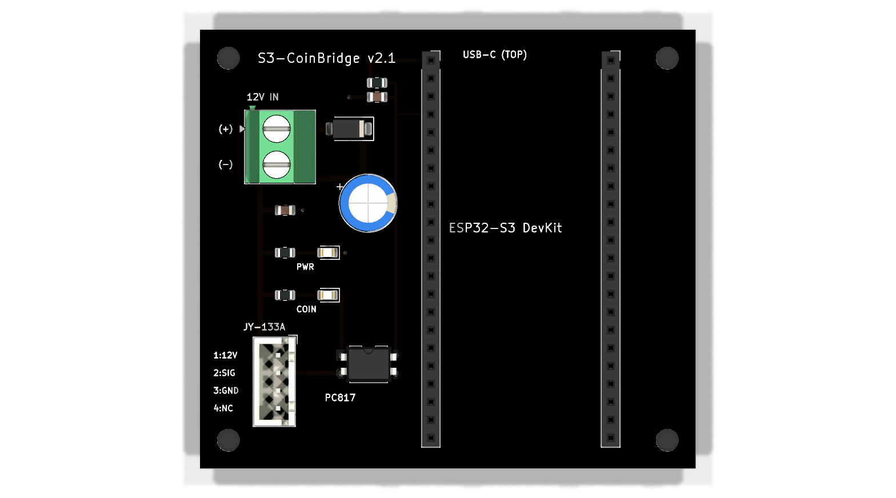

# S3-CoinBridge

**Carrier PCB (Shield) cho ESP32-S3 DevKit kết nối bộ nhận tiền xu JY-133A và nguồn tổ ong 12V cho Photobooth.**

---

## 📌 Tổng quan dự án

`S3-CoinBridge` là bo mạch trung gian phần cứng (Carrier Board) chuẩn công nghiệp, thiết kế để cắm trực tiếp module **ESP32-S3-DevKitC-1** (2x22 pin), nhận nguồn ngoài 12V từ nguồn tổ ong và giao tiếp an toàn với bộ nhận xu **JY-133A**.

* **Kích thước bo mạch:** 70.0 mm x 62.0 mm (siêu gọn, tối ưu không gian tủ máy Photobooth).
* **Số lớp:** 2 lớp (Top Copper + Bottom Copper Solid Ground Plane).
* **Mass chung (Common GND):** Mặt đáy phủ đồng mass GND liền khối, chống nhiễu vượt trội.
* **Tầng chuyển mức & bảo vệ:** Sử dụng Optocoupler **PC817** cách ly điện áp 12V $\rightarrow$ 3.3V, triệt tiêu 100% xung cảm ứng ngược (inductive kickback) từ cuộn hút solenoid của JY-133A, bảo vệ tuyệt đối ESP32 và Mac mini kết nối qua USB Serial.

---

## 🖼️ Hình ảnh 3D Render

| Góc nhìn từ trên (Top View) | Phối cảnh 3D (Isometric View) |
| :---: | :---: |
|  |  |

---

## 🔌 Sơ đồ kết nối & Chân cắm (Pinout)

### 1. Nguồn vào 12V (J1: KF301-2P / MKDS 5.08mm)
*Mặt cắm dây hướng ra cạnh ngoài bên trái bo mạch.*
* **Chân 1 `(+)`:** Nối vào ngõ `+12V` của nguồn tổ ong. (Có diode Schottky **SS34** 3A chống cắm ngược cực).
* **Chân 2 `(-)`:** Nối vào ngõ `COM / GND` của nguồn tổ ong.

### 2. Cổng kết nối JY-133A (J2: XH2.54 4-Pin)
*Thứ tự chân chuẩn của giắc cắm JY-133A đi kèm nhà sản xuất:*
* **Chân 1 (Đỏ):** `+12V` (Cấp nguồn nuôi cho đầu đọc xu).
* **Chân 2 (Trắng):** `COIN Signal` (Tín hiệu xung Open-Collector kích hoạt mức thấp khi có xu hợp lệ).
* **Chân 3 (Đen):** `GND` (Mass nguồn).
* **Chân 4 (Xám):** `NC` (Không kết nối / Counter line).

### 3. Đèn LED chỉ thị trạng thái
* **LED1 (Đỏ - PWR):** Sáng liên tục khi có nguồn 12V cấp vào bo.
* **LED2 (Xanh lá - COIN):** Nhấp nháy đồng bộ theo từng xung khi khách bỏ xu vào JY-133A.

### 4. Giao tiếp với ESP32-S3 DevKit
* **Chân GPIO4 (J3 Pin 4):** Nhận xung logic 3.3V (Mặc định mức HIGH nhờ trở kéo 10k R3; khi có xung xu, PC817 dẫn kéo GPIO4 xuống mức LOW).
* **Tụ lọc C3 (100nF):** Lọc rung phần cứng (hardware debouncing) giúp ESP32 đếm xung chính xác 100%, không bị xung ảo do nhiễu EMI.
* **Cổng USB-C (TOP):** Hướng lên cạnh trên bo mạch, cắm cáp USB về Mac mini chạy app Photobooth.

---

## 📋 Danh mục linh kiện (Bill of Materials - BOM)

| STT | Ký hiệu | Giá trị / Mã linh kiện | Footprint | Ghi chú |
| :---: | :--- | :--- | :--- | :--- |
| 1 | **U1** | PC817 (Sharp / Everlight) | DIP-4_W7.62mm | Optocoupler |
| 2 | **D1** | SS34 (3A / 40V Schottky) | SMA (DO-214AC) | Diode chống ngược cực |
| 3 | **C1** | 220µF / 25V | CP_Radial_D8.0mm_P3.50mm | Tụ hóa lọc nguồn 12V |
| 4 | **C2, C3** | 100nF (0.1µF) / 50V | C_0805_2012Metric | Tụ gốm lọc nhiễu SMD |
| 5 | **R1** | 2.2kΩ (1/8W, 5%) | R_0805_2012Metric | Trở hạn dòng LED PWR |
| 6 | **R2** | 1.0kΩ (1/4W, 5%) | R_0805_2012Metric | Trở hạn dòng LED COIN & Opto |
| 7 | **R3** | 10kΩ (1/8W, 5%) | R_0805_2012Metric | Trở kéo 3.3V GPIO4 |
| 8 | **LED1** | LED Đỏ (Red) | LED_0805_2012Metric | Báo nguồn |
| 9 | **LED2** | LED Xanh lá (Green) | LED_0805_2012Metric | Báo xung xu |
| 10 | **J1** | KF301-2P (Pitch 5.08mm) | MKDS-1,5-2-5.08 | Terminal vặn ốc nguồn 12V |
| 11 | **J2** | JST XH 4-Pin (Pitch 2.50/2.54mm) | JST_XH_B4B-XH-A_Vertical | Cắm dây JY-133A |
| 12 | **J3, J4** | Header rào cái 1x22 Pin (Pitch 2.54mm) | PinSocket_1x22_Vertical | Cắm ESP32-S3 DevKit |
| 13 | **H1 - H4** | Lỗ bắt ốc M3 | MountingHole_3.2mm_M3 | Bắt cố định vào tủ máy |

---

## 🚀 Hướng dẫn mở dự án trên KiCad

Dự án được tạo trên **KiCad 10.0** và đã được đóng gói **đầy đủ thư viện độc lập (Portable)**:
* **Thư viện Footprint nội bộ:** `S3-CoinBridge.pretty/` (Kèm bảng ánh xạ `fp-lib-table`).
* **Thư viện Symbol nội bộ:** `S3-CoinBridge.kicad_sym` (Kèm bảng ánh xạ `sym-lib-table`).

👉 **Bất kỳ máy tính nào cài KiCad (Windows, macOS, Linux) chỉ cần tải thư mục này về và mở file `S3-CoinBridge.kicad_pro` là xem, chỉnh sửa, xuất file bình thường mà không bị thiếu linh kiện.**

---

## 🏭 Đặt gia công sản xuất mạch (JLCPCB / PCBWay)

Toàn bộ file sản xuất đã được nén sẵn trong:
📦 **[`S3-CoinBridge-Gerbers.zip`](S3-CoinBridge-Gerbers.zip)**

**Thông số khuyên dùng khi đặt mạch:**
* **Dimensions:** 70 mm x 62 mm
* **Layer Count:** 2 Layers
* **PCB Thickness:** 1.6 mm
* **Copper Weight:** 1 oz
* **Surface Finish:** HASL with lead (hoặc LeadFree HASL / ENIG)
* **Solder Mask Color:** Xanh lá / Đen / Xanh dương
